# 🎭 Especificación de Casos de Uso: Facturador Simple Ecuador

Este documento contiene la especificación formal de los **Casos de Uso (CU)** del sistema. Un caso de uso describe de manera estructurada la interacción entre los diferentes actores (usuarios o sistemas externos) y el software para alcanzar un objetivo de negocio concreto.

---

## 👥 1. Actores del Sistema

| Actor | Tipo | Descripción y Responsabilidad |
| :--- | :--- | :--- |
| **Administrador** | Humano (Primario) | Usuario con control total del sistema. Configura los datos de la empresa emisora, administra usuarios, consulta todos los reportes y tiene acceso total a todos los módulos. |
| **Asesor Comercial** | Humano (Primario) | Personal de ventas encargado de registrar clientes, crear y emitir facturas, consultar comprobantes, anularlos en caso de error e imprimir comprobantes RIDE. |
| **Bodeguero** | Humano (Primario) | Responsable del almacén. Registra nuevos productos, actualiza precios/tarifas de IVA, monitorea el inventario y realiza ajustes o ingresos manuales de existencias. |
| **Sistema / Motor Transaccional** | Sistema (Secundario) | Componente interno que ejecuta de forma automática las operaciones de descuento o reposición de stock, cálculo de impuestos y auditoría en el Kardex. |

---

## 🗺️ 2. Diagrama de Casos de Uso (Mermaid)

```mermaid
graph TD
    subgraph Actores
        Admin["👤 Administrador"]
        Asesor["👤 Asesor Comercial"]
        Bodeguero["👤 Bodeguero"]
        Sistema["⚙️ Motor Transaccional"]
    end

    subgraph "Módulo de Seguridad"
        CU01["CU-01: Iniciar y Cerrar Sesión"]
    end

    subgraph "Módulo de Catálogo e Inventario"
        CU02["CU-02: Gestionar Productos"]
        CU03["CU-03: Realizar Ajuste de Inventario"]
        CU09["CU-09: Monitorear Stock Bajo"]
    end

    subgraph "Módulo de Clientes"
        CU04["CU-04: Registrar Cliente (Valida SRI)"]
    end

    subgraph "Módulo de Facturación"
        CU05["CU-05: Emitir Factura y Descontar Stock"]
        CU06["CU-06: Anular Factura y Reponer Stock"]
        CU07["CU-07: Imprimir Comprobante RIDE"]
    end

    subgraph "Módulo de Configuración"
        CU08["CU-08: Configurar Datos del Emisor"]
    end

    %% Relaciones de Admin
    Admin --> CU01
    Admin --> CU02
    Admin --> CU03
    Admin --> CU04
    Admin --> CU05
    Admin --> CU06
    Admin --> CU07
    Admin --> CU08
    Admin --> CU09

    %% Relaciones de Asesor
    Asesor --> CU01
    Asesor --> CU04
    Asesor --> CU05
    Asesor --> CU06
    Asesor --> CU07

    %% Relaciones de Bodeguero
    Bodeguero --> CU01
    Bodeguero --> CU02
    Bodeguero --> CU03
    Bodeguero --> CU09

    %% Relaciones del Sistema
    CU05 -.->|Invoca automáticamente| Sistema
    CU06 -.->|Invoca automáticamente| Sistema
```

---

## 📝 3. Casos de Uso Detallados

---

### CU-01: Iniciar Sesión y Derivación por Rol
* **Identificador**: CU-01
* **Nombre**: Iniciar Sesión en la Plataforma
* **Actores**: Administrador, Asesor Comercial, Bodeguero
* **Precondición**: El usuario debe estar previamente registrado en el sistema y con estado activo.
* **Disparador**: El usuario ingresa a la URL principal o intenta acceder a una vista protegida.

#### Flujo Principal:
1. El usuario accede a la pantalla de Login e ingresa su nombre de usuario y contraseña.
2. El sistema valida las credenciales y verifica que la cuenta no esté inhabilitada.
3. El sistema identifica el rol asignado (`PerfilUsuario`): Administrador, Asesor o Bodeguero.
4. El sistema inicia la sesión segura y redirige al Dashboard principal adaptado a las opciones y permisos del rol.

#### Flujos Alternativos / Excepciones:
* **2a. Credenciales incorrectas**: El sistema muestra el mensaje de error: *"Usuario o contraseña incorrectos"* y mantiene al usuario en la pantalla de login sin revelar qué campo falló.
* **3a. Usuario inactivo**: El sistema bloquea el acceso e indica que el usuario está deshabilitado.

#### Postcondición:
* La sesión queda autenticada; se habilitan los accesos y menús correspondientes según el rol.

---

### CU-02: Registrar y Gestionar Producto en Catálogo
* **Identificador**: CU-02
* **Nombre**: Registrar o Editar Producto
* **Actores**: Bodeguero, Administrador
* **Precondición**: El usuario debe haber iniciado sesión con rol Bodeguero o Administrador.
* **Disparador**: Clic en "Nuevo Producto" o en "Editar" sobre un ítem existente.

#### Flujo Principal:
1. El usuario completa el formulario: Código/SKU, Nombre, Descripción, Precio Unitario sin IVA, Tarifa de IVA (15% o 0%) y Stock Mínimo.
2. Si es un producto nuevo, se puede ingresar un stock inicial.
3. El usuario pulsa "Guardar Producto".
4. El sistema valida que el código SKU no esté repetido y que los valores numéricos sean positivos.
5. El sistema persiste el producto en la base de datos y crea un movimiento inicial en el Kardex si se asignó stock.
6. El sistema redirige a la lista de productos con un mensaje de éxito.

#### Flujos Alternativos / Excepciones:
* **4a. Código SKU duplicado**: El sistema muestra el error: *"Ya existe un producto con este código SKU"* y conserva los datos ingresados en el formulario.
* **4b. Precio negativo**: El sistema rechaza el formulario indicando que el precio no puede ser menor a cero.

#### Postcondición:
* El producto queda disponible para ser facturado en el catálogo.

---

### CU-03: Realizar Entrada o Ajuste Manual de Inventario (Kardex)
* **Identificador**: CU-03
* **Nombre**: Realizar Entrada o Ajuste de Stock
* **Actores**: Bodeguero, Administrador
* **Precondición**: El producto debe existir en el catálogo.
* **Disparador**: El usuario ingresa a "Ajustar Stock" desde la vista de inventario.

#### Flujo Principal:
1. El usuario selecciona el producto a ajustar.
2. El sistema muestra el stock actual registrado en la base de datos.
3. El usuario selecciona el tipo de movimiento (`INGRESO` para sumar unidades, o `AJUSTE` para corrección) e ingresa la cantidad y el motivo de la operación (ej. *"Recepción Factura Proveedor #4092"* o *"Corrección por conteo físico cíclico"*).
4. El usuario confirma la operación.
5. El sistema calcula el nuevo stock, actualiza el registro del producto y genera un registro histórico en `MovimientoInventario`.
6. El sistema notifica el éxito del ajuste.

#### Flujos Alternativos / Excepciones:
* **3a. Motivo vacío**: El sistema exige ingresar una justificación obligatoria para auditoría.
* **4a. Ajuste genera stock negativo**: El sistema cancela la operación y advierte que el stock resultante no puede ser menor a cero.

#### Postcondición:
* El stock del producto queda actualizado y queda una traza inmutable en el Kardex.

---

### CU-04: Registrar Cliente con Validación de Cédula/RUC Ecuador
* **Identificador**: CU-04
* **Nombre**: Registrar Cliente para Facturación
* **Actores**: Asesor Comercial, Administrador
* **Precondición**: Usuario con permisos comerciales autenticado.
* **Disparador**: Clic en "Nuevo Cliente" en el módulo de clientes.

#### Flujo Principal:
1. El usuario selecciona el tipo de identificación: `05 - Cédula`, `04 - RUC`, `06 - Pasaporte` o `07 - Consumidor Final`.
2. Ingresa el número de identificación, nombres completos, correo, teléfono y dirección.
3. Pulsa "Guardar Cliente".
4. El sistema ejecuta el validador algorítmico correspondiente:
   - Si es Cédula: Ejecuta el algoritmo de Módulo 10 sobre los 10 dígitos.
   - Si es RUC: Comprueba el tercer dígito y ejecuta el algoritmo de Módulo 10 o Módulo 11 según corresponda.
   - Si es Consumidor Final: Verifica que sea exactamente `9999999999999`.
5. Si el documento es matemáticamente válido, el sistema guarda el cliente.
6. El sistema redirige al listado mostrando un mensaje de confirmación.

#### Flujos Alternativos / Excepciones:
* **4a. Cédula inválida (dígito verificador incorrecto)**: El sistema rechaza el guardado y muestra: *"La cédula ingresada no es válida según el estándar del Registro Civil de Ecuador"*.
* **4b. RUC inválido**: El sistema muestra: *"El RUC ingresado no cumple con el algoritmo del SRI"*.
* **4c. Identificación duplicada**: El sistema indica que ya existe un cliente con ese número.

#### Postcondición:
* El cliente queda registrado y habilitado para ser seleccionado en nuevas facturas.

---

### CU-05: Emitir Factura y Descontar Inventario Automáticamente (Caso de Uso Central)
* **Identificador**: CU-05
* **Nombre**: Emitir Factura de Venta
* **Actores**: Asesor Comercial, Administrador, Sistema
* **Precondición**: Existen clientes registrados y productos con stock disponible en el inventario.
* **Disparador**: El usuario accede a "Nueva Factura".

#### Flujo Principal:
1. El usuario selecciona el cliente desde la lista desplegable o busca por cédula/nombre.
2. Selecciona la forma de pago según el SRI (Efectivo, Débito, Crédito o Transferencia).
3. Añade uno o varios productos a la tabla de detalles, especificando la cantidad y descuento opcional.
4. El sistema en el cliente (JavaScript) calcula en tiempo real los subtotales por ítem, subtotal 15%, subtotal 0%, IVA 15% y Total general.
5. El usuario verifica los montos y pulsa "Emitir Factura".
6. Se envía la solicitud al backend (`FacturacionService.emitir_factura`):
   a. Se abre un bloque transaccional atómico (`transaction.atomic`).
   b. Para cada ítem, se aplica un bloqueo de fila (`select_for_update`) sobre el producto en la BD.
   c. Se valida que `producto.stock >= cantidad`.
   d. Se genera el número secuencial correlativo oficial según el emisor (`001-001-000000001`).
   e. Se guarda la cabecera `Factura` y cada renglón en `DetalleFactura`.
   f. Se descuenta el stock de cada producto (`producto.stock -= cantidad`).
   g. Se inserta un registro en `MovimientoInventario` con tipo `EGRESO_VENTA` vinculado a la factura.
   h. Se incrementa el secuencial actual en la configuración del emisor.
   i. Se confirma la transacción en la base de datos (*Commit*).
7. El sistema redirige a la vista de detalle de la factura recién emitida con la opción de impresión RIDE.

#### Flujos Alternativos / Excepciones:
* **6c. Stock insuficiente para uno o más productos**:
  * El sistema interrumpe el proceso, hace un *Rollback* automático de toda la transacción y notifica al usuario: *"Stock insuficiente para '[Nombre del Producto]'. Disponible: X, Solicitado: Y"*.
  * No se guarda la factura ni se altera el inventario de ningún otro producto.
* **3a. La factura no contiene renglones**:
  * El sistema rechaza la petición indicando que debe incluir al menos un producto.

#### Postcondición:
* La factura queda registrada con estado `EMITIDA`.
* El inventario de los productos involucrados disminuye inmediatamente.
* Se generan los registros de auditoría en el Kardex.

---

### CU-06: Anular Factura y Reponer Stock Automáticamente
* **Identificador**: CU-06
* **Nombre**: Anular Factura Emitida
* **Actores**: Asesor Comercial, Administrador, Sistema
* **Precondición**: La factura debe encontrarse en estado `EMITIDA`.
* **Disparador**: El usuario pulsa el botón "Anular Factura" en el detalle del comprobante.

#### Flujo Principal:
1. El usuario visualiza los datos de la factura y pulsa "Anular Factura".
2. El sistema solicita confirmación y un motivo de anulación (ej. *"Devolución por producto defectuoso"* o *"Error en digitación de cliente"*).
3. El usuario confirma la anulación.
4. El sistema ejecuta `factura.anular()` dentro de una transacción atómica:
   a. Cambia el estado de la factura a `ANULADA`.
   b. Agrega el motivo y la fecha a las observaciones de la factura.
   c. Itera sobre cada ítem de `DetalleFactura` y reintegra las cantidades al inventario (`producto.stock += detalle.cantidad`).
   d. Registra un movimiento de tipo `DEVOLUCION_ANULACION` en el Kardex.
5. El sistema confirma la anulación y actualiza la vista.

#### Flujos Alternativos / Excepciones:
* **3a. Factura previamente anulada**: El sistema impide la acción y lanza `ValidationError("Esta factura ya se encuentra anulada")`.

#### Postcondición:
* La factura queda inhabilitada con estado `ANULADA`.
* Las unidades regresan exactamente al stock disponible.
* El Kardex refleja la devolución.

---

### CU-07: Visualizar e Imprimir Comprobante Físico (RIDE SRI)
* **Identificador**: CU-07
* **Nombre**: Imprimir Comprobante RIDE
* **Actores**: Asesor Comercial, Administrador
* **Precondición**: La factura debe haber sido emitida.
* **Disparador**: Clic en "Imprimir / Guardar PDF".

#### Flujo Principal:
1. El usuario abre la vista de la factura (`factura_detalle`).
2. Presiona el botón "Imprimir / Guardar PDF".
3. Se invoca el cuadro de impresión nativo del navegador (`window.print()`).
4. La hoja de estilos CSS `@media print` adapta automáticamente el diseño:
   - Oculta la barra de navegación superior, los botones de acción y los elementos del pie de página.
   - Aplica márgenes de impresión en formato A4.
   - Presenta el membrete de la empresa, el cuadro de datos del cliente, la tabla de renglones ordenados y el desglose de totales en el lateral derecho inferior.
5. El usuario envía el documento a la impresora física o lo guarda como archivo PDF.

#### Postcondición:
* El cliente final recibe su comprobante impreso o en formato digital PDF con la distribución visual adecuada.

---

### CU-08: Configurar Parámetros Fiscales del Emisor
* **Identificador**: CU-08
* **Nombre**: Actualizar Datos de Facturación de la Empresa
* **Actores**: Administrador
* **Precondición**: Usuario autenticado con rol `ADMINISTRADOR`.
* **Disparador**: Clic en el menú "Configuración SRI".

#### Flujo Principal:
1. El administrador accede al formulario de configuración del emisor.
2. Modifica los campos necesarios: Razón Social, RUC de la empresa, Nombre Comercial, Dirección Matriz, Código de Establecimiento (3 dígitos), Punto de Emisión (3 dígitos), Secuencial actual y Tarifa de IVA por defecto (15%).
3. Pulsa "Guardar Configuración".
4. El sistema actualiza el registro singleton `Emisor` en la base de datos.
5. Las futuras facturas tomarán estos nuevos parámetros.

#### Postcondición:
* Los datos de cabecera de las nuevas facturas reflejan la configuración establecida.

---

### CU-09: Monitorear Existencias y Alertas de Stock Bajo
* **Identificador**: CU-09
* **Nombre**: Monitoreo de Inventario y Alertas
* **Actores**: Bodeguero, Administrador
* **Precondición**: Existen productos registrados en el sistema.
* **Disparador**: El usuario consulta el Dashboard o la sección de Inventario.

#### Flujo Principal:
1. El usuario accede al Dashboard o a la lista de inventario.
2. El sistema consulta todos los productos y compara `stock` vs `stock_minimo`.
3. Para cada producto cuyo stock esté por debajo del límite de seguridad, el sistema renderiza un distintivo visual (*badge*) de alerta en color rojo (`Stock Bajo`).
4. En el Dashboard se muestra la tarjeta de resumen indicando cuántos ítems requieren reabastecimiento urgente.
5. El Bodeguero puede hacer clic en el producto y proceder a un reabastecimiento (CU-03).

#### Postcondición:
* El personal de bodega conoce oportunamente las necesidades de reposición de mercadería.

---

## 👨‍🏫 Nota Pedagógica para los Estudiantes

### ¿Por qué los Casos de Uso son indispensables para programar con Inteligencia Artificial?
Un modelo de lenguaje genera código prediciendo el siguiente token. Si únicamente le pides: *"Haz la función para anular facturas"*, el modelo podría simplemente cambiar el campo `estado = 'ANULADA'`, olvidando por completo **devolver el stock a la bodega** o **generar el movimiento en el Kardex**.

Al facilitarle el **CU-06** detallado:
1. La IA lee el **Flujo Principal paso a paso** (cambio de estado -> iteración de ítems -> incremento de stock -> creación de Kardex).
2. La IA deduce automáticamente la necesidad de usar una transacción atómica (`with transaction.atomic():`).
3. La IA programa pruebas unitarias cubriendo tanto el flujo feliz como las excepciones descritas.
