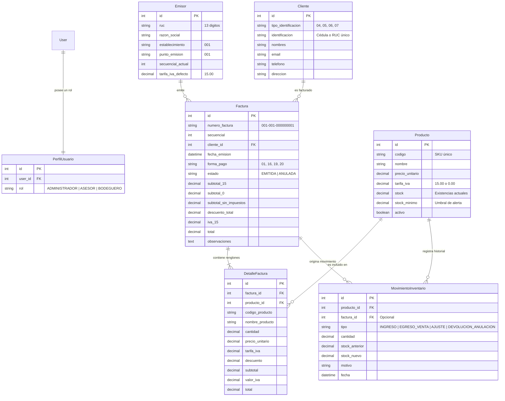
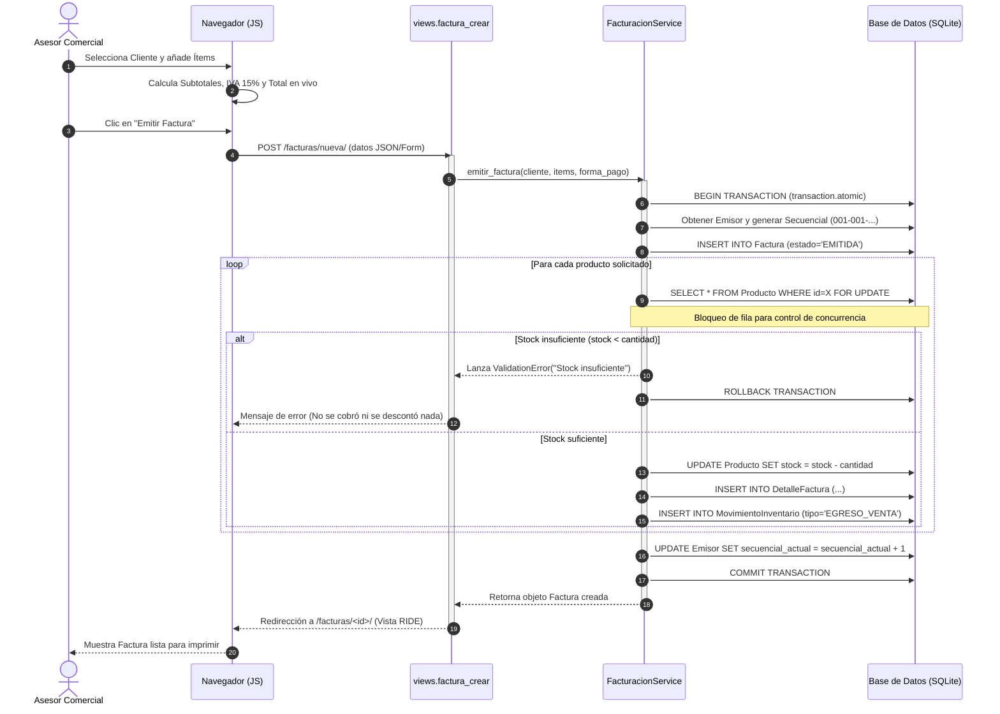

# 🏛️ Arquitectura y Modelo de Datos: Facturador Simple Ecuador

Este documento describe la arquitectura de software, el diseño de la base de datos y los flujos de integración del sistema **Facturador Simple Ecuador**. Provee la visión estructural interna necesaria para desarrolladores e inteligencias artificiales antes de modificar o extender el código.

---

## 🏗️ 1. Arquitectura de Software: Patrón MVC / MVT en Django

El proyecto implementa el patrón **Modelo-Vista-Controlador (MVC)**, adaptado por Django bajo la terminología **Modelo-Vista-Template (MVT)** con una capa adicional de **Servicios de Negocio** para desacoplar responsabilidades:

```
┌─────────────────────────────────────────────────────────────────────────────┐
│                       CAPA DE PRESENTACIÓN (V / T)                          │
│                                                                             │
│   ┌───────────────────────────────┐     ┌───────────────────────────────┐   │
│   │    Plantillas HTML (Bootstrap)│     │   Lógica Frontend (JS Vanilla)│   │
│   │    - base.html, factura_crear │     │   - Cálculo dinámico de IVA   │   │
│   │    - RIDE para impresión A4   │     │   - Actualización de totales  │   │
│   └───────────────▲───────────────┘     └───────────────▲───────────────┘   │
└───────────────────┼─────────────────────────────────────┼───────────────────┘
                    │ Petición HTTP / Respuesta           │ Eventos DOM
┌───────────────────▼─────────────────────────────────────▼───────────────────┐
│                        CAPA DE CONTROLADOR (Vistas)                         │
│                                                                             │
│   ┌─────────────────────────────────────────────────────────────────────┐   │
│   │ views.py (Thin Controllers)                                         │   │
│   │ - Manejo de sesión y autenticación (@login_required)                │   │
│   │ - Control de acceso por rol (@role_required)                        │   │
│   │ - Validación de entrada HTTP (POST / GET)                           │   │
│   └──────────────────────────────────▲──────────────────────────────────┘   │
└──────────────────────────────────────┼──────────────────────────────────────┘
                                       │ Orquesta la operación
┌──────────────────────────────────────▼──────────────────────────────────────┐
│                    CAPA DE SERVICIOS (Lógica de Negocio)                    │
│                                                                             │
│   ┌─────────────────────────────────────────────────────────────────────┐   │
│   │ FacturacionService (services.py)                                    │   │
│   │ - Orquestación de transacción ACID (@transaction.atomic)           │   │
│   │ - Bloqueo de fila para concurrencia (.select_for_update())          │   │
│   │ - Reglas tributarias y redondeo a 2 decimales (ROUND_HALF_UP)       │   │
│   └──────────────────────────────────▲──────────────────────────────────┘   │
└──────────────────────────────────────┼──────────────────────────────────────┘
                                       │ Persistencia / ORM
┌──────────────────────────────────────▼──────────────────────────────────────┐
│                        CAPA DE DOMINIO (Modelos M)                          │
│                                                                             │
│   ┌───────────────┐  ┌───────────────┐  ┌───────────────┐  ┌────────────┐   │
│   │    Emisor     │  │    Cliente    │  │   Producto    │  │  Factura   │   │
│   │ (Config SRI)  │  │(Validación ID)│  │ (Stock e IVA) │  │  (Cabecera)│   │
│   └───────────────┘  └───────────────┘  └───────────────┘  └──────┬─────┘   │
│                                                                   │         │
│   ┌───────────────────────────────┐     ┌─────────────────────────▼─────┐   │
│   │     MovimientoInventario      │     │        DetalleFactura         │   │
│   │       (Kardex Histórico)      │     │      (Renglones de Venta)     │   │
│   └───────────────────────────────┘     └───────────────────────────────┘   │
└──────────────────────────────────────▲──────────────────────────────────────┘
                                       │ SQL Nativo
┌──────────────────────────────────────▼──────────────────────────────────────┐
│                         MOTOR DE BASE DE DATOS                              │
│                                                                             │
│   SQLite 3 (db.sqlite3)  -- [Preparado para migrar a PostgreSQL en Producción]│
└─────────────────────────────────────────────────────────────────────────────┘
```

### Principio de Diseño: *Fat Models / Services, Thin Views*
* **Vistas delgadas (`views.py`)**: Se limitan a recibir la petición, verificar permisos del rol, invocar al servicio y retornar una respuesta HTML o JSON.
* **Capa de Servicios (`services.py`)**: Contiene la lógica compleja de negocio, asegurando que si mañana se agrega una API REST o una interfaz móvil, la lógica de emisión y descuento de inventario se reutilice sin duplicar código.

---

## 🗄️ 2. Diagrama Entidad - Relación (Mermaid)

El siguiente diagrama modela las entidades del sistema y sus relaciones cardinales:



---

## ⚡ 3. Diagrama de Secuencia: Flujo Transaccional de Facturación (ACID)

La emisión de una factura involucra múltiples operaciones dependientes que deben ejecutarse como una **unidad atómica**. Si cualquiera de ellas falla, el sistema debe revertir todos los cambios (*Rollback*):



---

## 🔒 4. Integridad y Control de Concurrencia

1. **Bloqueo a Nivel de Fila (`select_for_update`)**:
   En entornos con múltiples asesores vendiendo al mismo tiempo, existe el riesgo de que dos personas vendan la última unidad existente simultáneamente (*condición de carrera*). El uso de `select_for_update` garantiza que el primer proceso que consulte el producto bloquee el registro hasta finalizar la transacción, obligando al segundo proceso a esperar y evaluar el stock actualizado.
2. **Uso de Tipo de Dato `Decimal`**:
   Para aplicaciones financieras y tributarias, los tipos de dato de punto flotante (`float`) son inadmisibles debido a los errores de redondeo binario. Toda la aplicación utiliza `Decimal` con redondeo estándar financiero `ROUND_HALF_UP`.
3. **Restricción de Borrado (`on_delete=models.PROTECT`)**:
   Ni los clientes ni los productos que ya cuenten con historial de facturación pueden ser eliminados físicamente de la base de datos, garantizando la preservación histórica y la validez de los reportes contables.
