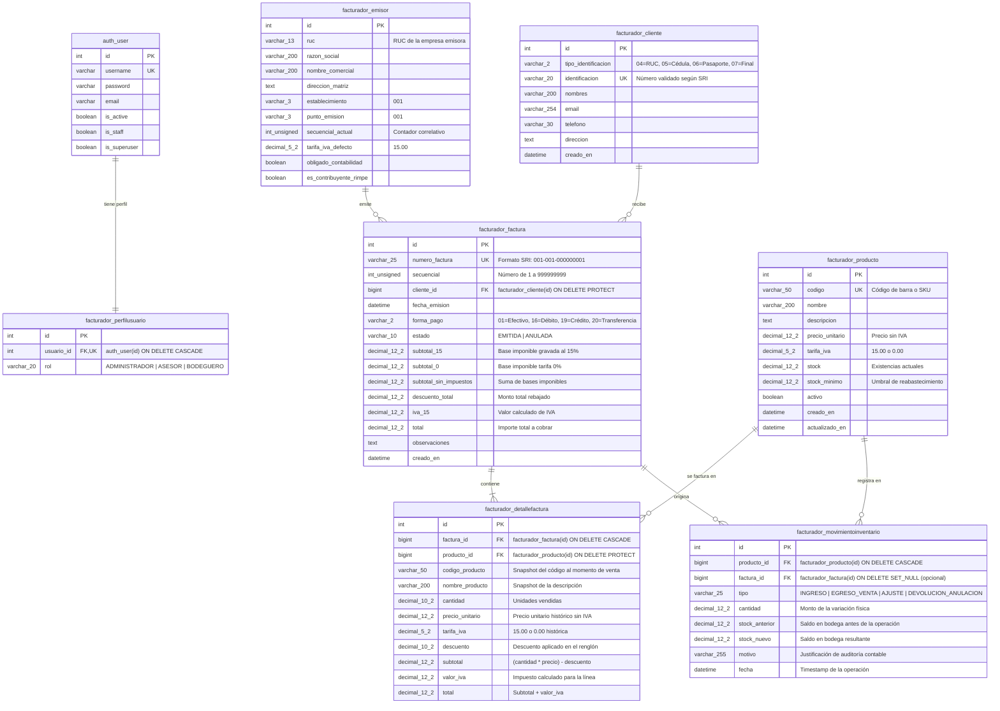

# 🗄️ Diseño de Base de Datos: Facturador Simple Ecuador

Este documento contiene la especificación formal del **Modelo de Datos Relacional**, el **Diccionario de Datos** y las **Reglas de Integridad Referencial** del sistema **Facturador Simple Ecuador**. Está diseñado para servir como material de estudio en cursos de Base de Datos e Ingeniería de Software, así como directriz inmutable de persistencia para herramientas de Inteligencia Artificial.

---

## 🎯 1. Principios de Diseño del Modelo de Datos

1. **Integridad Transaccional (ACID)**:
   Todas las tablas financieras y de inventario están diseñadas para interactuar bajo transacciones atómicas.
2. **Inmutabilidad y Auditoría Histórica (*Snapshotting*)**:
   En facturación no se puede aplicar una normalización purista ciega. Si un producto cambia de precio o de nombre en el futuro, las facturas ya emitidas **no deben verse alteradas**. Por ello, la tabla de renglones (`facturador_detallefactura`) almacena una captura histórica (*snapshot*) de los datos del producto al momento de la venta.
3. **Precisión Numérica Exacta (`DECIMAL` vs `FLOAT`)**:
   Los valores monetarios e impositivos se modelan exclusivamente mediante tipos `DecimalField` (en base de datos `DECIMAL(12, 2)` o `NUMERIC`). Se prohíbe el uso de punto flotante (`FLOAT` o `DOUBLE`) debido al error de redondeo binario del estándar IEEE 754.
4. **Protección Contra Borrados Accidentales**:
   Se aplican políticas de eliminación `models.PROTECT` en entidades críticas para impedir la eliminación de productos o clientes con historial comercial activo.

---

## 🗺️ 2. Diagrama Entidad-Relación Físico (DER / ERD)



---

## 📖 3. Diccionario de Datos (Data Dictionary)

### Tabla 1: `facturador_emisor` (Configuración de la Empresa Emisora)
Almacena los datos fiscales de la empresa que emite los comprobantes ante el SRI (Patrón *Singleton*, normalmente `id = 1`).

| Columna | Tipo de Dato SQL | Django Field | Nulo | Clave | Descripción |
| :--- | :--- | :--- | :---: | :---: | :--- |
| `id` | `INTEGER` | `BigAutoField` | NO | PK | Identificador único autoincremental. |
| `ruc` | `VARCHAR(13)` | `CharField(13)` | NO | - | RUC de 13 dígitos de la empresa emisora. |
| `razon_social` | `VARCHAR(200)` | `CharField(200)` | NO | - | Nombre legal / Razón social registrada en el SRI. |
| `nombre_comercial` | `VARCHAR(200)` | `CharField(200)` | NO | - | Nombre comercial del establecimiento. |
| `direccion_matriz` | `TEXT` | `TextField` | NO | - | Dirección física de la casa matriz. |
| `establecimiento` | `VARCHAR(3)` | `CharField(3)` | NO | - | Código del establecimiento SRI (ej. `001`). |
| `punto_emision` | `VARCHAR(3)` | `CharField(3)` | NO | - | Código del punto de emisión SRI (ej. `001`). |
| `secuencial_actual` | `INTEGER UNSIGNED`| `PositiveIntegerField` | NO | - | Contador secuencial de facturas (ej. `1`). |
| `tarifa_iva_defecto`| `DECIMAL(5, 2)` | `DecimalField` | NO | - | Tarifa de IVA predeterminada (Default: `15.00`). |
| `obligado_contabilidad`| `BOOLEAN` | `BooleanField` | NO | - | Indica si el emisor debe llevar contabilidad. |
| `es_contribuyente_rimpe`| `BOOLEAN` | `BooleanField` | NO | - | Indica si pertenece al régimen RIMPE del SRI. |

---

### Tabla 2: `facturador_cliente` (Directorio de Clientes)
Registra la información de los compradores y receptores de facturas con validación estricta de documentos del Ecuador.

| Columna | Tipo de Dato SQL | Django Field | Nulo | Clave | Descripción |
| :--- | :--- | :--- | :---: | :---: | :--- |
| `id` | `INTEGER` | `BigAutoField` | NO | PK | Identificador del cliente. |
| `tipo_identificacion` | `VARCHAR(2)` | `CharField(2)` | NO | - | Catálogo SRI: `04` (RUC), `05` (Cédula), `06` (Pasaporte), `07` (Consumidor Final). |
| `identificacion` | `VARCHAR(20)` | `CharField(20)` | NO | UNIQUE | Número de identificación validado por Módulo 10/11. |
| `nombres` | `VARCHAR(200)` | `CharField(200)` | NO | - | Nombres y apellidos completos o razón social. |
| `email` | `VARCHAR(254)` | `EmailField` | NO | - | Correo electrónico para envío del comprobante RIDE. |
| `telefono` | `VARCHAR(30)` | `CharField(30)` | NO | - | Número telefónico de contacto. |
| `direccion` | `TEXT` | `TextField` | NO | - | Dirección física del cliente. |
| `creado_en` | `DATETIME` | `DateTimeField` | NO | - | Fecha y hora de alta en el sistema (`auto_now_add`). |

---

### Tabla 3: `facturador_producto` (Catálogo de Productos y Existencias)
Contiene los productos comercializados, su tarifa impositiva individual y el stock disponible en almacén.

| Columna | Tipo de Dato SQL | Django Field | Nulo | Clave | Descripción |
| :--- | :--- | :--- | :---: | :---: | :--- |
| `id` | `INTEGER` | `BigAutoField` | NO | PK | Identificador del producto. |
| `codigo` | `VARCHAR(50)` | `CharField(50)` | NO | UNIQUE | Código SKU, identificador de catálogo o código de barra. |
| `nombre` | `VARCHAR(200)` | `CharField(200)` | NO | - | Denominación comercial del ítem. |
| `descripcion` | `TEXT` | `TextField` | NO | - | Descripción técnica o características del producto. |
| `precio_unitario` | `DECIMAL(12, 2)`| `DecimalField` | NO | - | Precio base de venta sin impuestos. |
| `tarifa_iva` | `DECIMAL(5, 2)` | `DecimalField` | NO | - | Porcentaje de IVA aplicable (`15.00` o `0.00`). |
| `stock` | `DECIMAL(12, 2)`| `DecimalField` | NO | - | Unidades físicas actualmente disponibles en bodega. |
| `stock_minimo` | `DECIMAL(12, 2)`| `DecimalField` | NO | - | Límite de seguridad para generar alertas de stock bajo. |
| `activo` | `BOOLEAN` | `BooleanField` | NO | - | Bandera para deshabilitar ventas del ítem (borrado lógico). |
| `creado_en` | `DATETIME` | `DateTimeField` | NO | - | Fecha de registro inicial. |
| `actualizado_en` | `DATETIME` | `DateTimeField` | NO | - | Timestamp de la última modificación. |

---

### Tabla 4: `facturador_factura` (Cabecera de Comprobante de Venta)
Representa la transacción comercial general y los totales tributarios exigidos por el SRI.

| Columna | Tipo de Dato SQL | Django Field | Nulo | Clave | Descripción |
| :--- | :--- | :--- | :---: | :---: | :--- |
| `id` | `INTEGER` | `BigAutoField` | NO | PK | Identificador interno de la factura. |
| `numero_factura` | `VARCHAR(25)` | `CharField(25)` | NO | UNIQUE | Número oficial SRI (`001-001-000000001`). |
| `secuencial` | `INTEGER UNSIGNED`| `PositiveIntegerField` | NO | - | Número correlativo interno de 9 dígitos. |
| `cliente_id` | `BIGINT` | `ForeignKey` | NO | FK | Clave foránea a `facturador_cliente`. `ON DELETE PROTECT`. |
| `fecha_emision` | `DATETIME` | `DateTimeField` | NO | INDEX | Fecha y hora en que se emite la factura. |
| `forma_pago` | `VARCHAR(2)` | `CharField(2)` | NO | - | Código SRI: `01` (Efectivo), `16` (Débito), `19` (Crédito), `20` (Transferencia). |
| `estado` | `VARCHAR(10)` | `CharField(10)` | NO | - | Estado de la factura: `EMITIDA` o `ANULADA`. |
| `subtotal_15` | `DECIMAL(12, 2)`| `DecimalField` | NO | - | Base imponible total gravada con IVA del 15%. |
| `subtotal_0` | `DECIMAL(12, 2)`| `DecimalField` | NO | - | Base imponible total gravada con tarifa 0%. |
| `subtotal_sin_impuestos`| `DECIMAL(12, 2)`| `DecimalField` | NO | - | Suma de `subtotal_15 + subtotal_0`. |
| `descuento_total` | `DECIMAL(12, 2)`| `DecimalField` | NO | - | Suma total de descuentos otorgados. |
| `iva_15` | `DECIMAL(12, 2)`| `DecimalField` | NO | - | Monto exacto calculado del IVA 15%. |
| `total` | `DECIMAL(12, 2)`| `DecimalField` | NO | - | Importe final a cancelar (`subtotal_sin_impuestos + iva_15`). |
| `observaciones` | `TEXT` | `TextField` | NO | - | Notas adicionales o motivo de anulación si aplica. |
| `creado_en` | `DATETIME` | `DateTimeField` | NO | - | Fecha de persistencia en base de datos. |

---

### Tabla 5: `facturador_detallefactura` (Renglones / Ítems de la Factura)
Detalla los productos vendidos en cada factura, guardando el precio y nombre histórico al momento de la transacción.

| Columna | Tipo de Dato SQL | Django Field | Nulo | Clave | Descripción |
| :--- | :--- | :--- | :---: | :---: | :--- |
| `id` | `INTEGER` | `BigAutoField` | NO | PK | Identificador del renglón. |
| `factura_id` | `BIGINT` | `ForeignKey` | NO | FK | Factura a la que pertenece el renglón. `ON DELETE CASCADE`. |
| `producto_id` | `BIGINT` | `ForeignKey` | NO | FK | Producto de catálogo asociado. `ON DELETE PROTECT`. |
| `codigo_producto` | `VARCHAR(50)` | `CharField(50)` | NO | - | *Snapshot*: Código del producto al momento de vender. |
| `nombre_producto` | `VARCHAR(200)` | `CharField(200)` | NO | - | *Snapshot*: Descripción del producto al momento de vender. |
| `cantidad` | `DECIMAL(10, 2)`| `DecimalField` | NO | - | Unidades despachadas. |
| `precio_unitario` | `DECIMAL(12, 2)`| `DecimalField` | NO | - | *Snapshot*: Precio unitario aplicado. |
| `tarifa_iva` | `DECIMAL(5, 2)` | `DecimalField` | NO | - | *Snapshot*: Tarifa de IVA aplicada (`15.00` o `0.00`). |
| `descuento` | `DECIMAL(10, 2)`| `DecimalField` | NO | - | Descuento directo en este renglón. |
| `subtotal` | `DECIMAL(12, 2)`| `DecimalField` | NO | - | `(cantidad * precio_unitario) - descuento`. |
| `valor_iva` | `DECIMAL(12, 2)`| `DecimalField` | NO | - | Impuesto correspondiente a este ítem. |
| `total` | `DECIMAL(12, 2)`| `DecimalField` | NO | - | Total final de la línea (`subtotal + valor_iva`). |

---

### Tabla 6: `facturador_movimientoinventario` (Kardex Histórico Inmutable)
Libro diario de auditoría física de entradas, salidas y ajustes de mercadería.

| Columna | Tipo de Dato SQL | Django Field | Nulo | Clave | Descripción |
| :--- | :--- | :--- | :---: | :---: | :--- |
| `id` | `INTEGER` | `BigAutoField` | NO | PK | Identificador del movimiento de inventario. |
| `producto_id` | `BIGINT` | `ForeignKey` | NO | FK | Producto afectado. `ON DELETE CASCADE`. |
| `factura_id` | `BIGINT` | `ForeignKey` | SÍ | FK | Factura vinculada (si fue por venta o anulación). `ON DELETE SET_NULL`. |
| `tipo` | `VARCHAR(25)` | `CharField(25)` | NO | - | `INGRESO`, `EGRESO_VENTA`, `AJUSTE`, `DEVOLUCION_ANULACION`. |
| `cantidad` | `DECIMAL(12, 2)`| `DecimalField` | NO | - | Variación física (siempre positiva). |
| `stock_anterior` | `DECIMAL(12, 2)`| `DecimalField` | NO | - | Existencias en bodega antes del movimiento. |
| `stock_nuevo` | `DECIMAL(12, 2)`| `DecimalField` | NO | - | Existencias en bodega tras aplicar el movimiento. |
| `motivo` | `VARCHAR(255)` | `CharField(255)` | NO | - | Justificación de la operación para auditoría. |
| `fecha` | `DATETIME` | `DateTimeField` | NO | INDEX | Timestamp exacto de la operación (`auto_now_add`). |

---

### Tabla 7: `facturador_perfilusuario` (Control de Roles RBAC)
Extiende el modelo de usuarios nativo de Django para asignar los perfiles de acceso.

| Columna | Tipo de Dato SQL | Django Field | Nulo | Clave | Descripción |
| :--- | :--- | :--- | :---: | :---: | :--- |
| `id` | `INTEGER` | `BigAutoField` | NO | PK | Identificador del perfil. |
| `usuario_id` | `INTEGER` | `OneToOneField`| NO | FK, UK | Referencia 1 a 1 a `auth_user(id)`. `ON DELETE CASCADE`. |
| `rol` | `VARCHAR(20)` | `CharField(20)` | NO | - | Rol asignado: `ADMINISTRADOR`, `ASESOR` o `BODEGUERO`. |

---

## 💡 4. Decisiones Críticas de Modelado para los Alumnos

### A. ¿Por qué duplicamos datos en `DetalleFactura`? (*Snapshotting*)
En teoría pura de base de datos se enseña que duplicar columnas rompe la Tercera Forma Normal (3FN). Sin embargo, en el mundo real de la contabilidad y la facturación, **la normalización pura es un grave error de diseño**.

> ⚠️ **El Escenario del Error Clásico:**  
> Si `DetalleFactura` no guardara `precio_unitario` y dependiera de un `JOIN` con la tabla `Producto`:  
> Si el producto "Arroz 1kg" se vendió en 2024 a **$1.00**, y en 2026 sube por inflación a **$1.80**:  
> Al reimprimir la factura de 2024, el sistema mostraría que el cliente pagó $1.80. **Esto causaría una catástrofe fiscal y legal ante el SRI.**

Por ello, se realiza una **desnormalización controlada**: `codigo_producto`, `nombre_producto`, `precio_unitario` y `tarifa_iva` se graban como una foto inmutable en el instante de la venta.

---

### B. Políticas de Integridad Referencial (`ON DELETE`)

1. **`models.PROTECT` en Clientes y Productos**:
   ```python
   cliente = models.ForeignKey(Cliente, on_delete=models.PROTECT)
   producto = models.ForeignKey(Producto, on_delete=models.PROTECT)
   ```
   Si un usuario intenta borrar un cliente o un producto que ya fue facturado en el pasado, el motor de base de datos lanza un error `ProtectedError`. La ley tributaria ecuatoriana exige conservar la trazabilidad de los comprobantes por al menos 7 años.

2. **`models.SET_NULL` en Movimientos de Inventario**:
   ```python
   factura = models.ForeignKey(Factura, null=True, blank=True, on_delete=models.SET_NULL)
   ```
   Si en algún mantenimiento administrativo se purgara una factura, el historial físico de inventario (Kardex) no debe destruirse; simplemente la referencia a la factura se vuelve `NULL`, preservando el conteo de existencias.

---

## ⚡ 5. Estrategia de Índices y Rendimiento

El diseño incluye índices en columnas estratégicas para acelerar las consultas más frecuentes:

1. **Índices Únicos (*B-Tree Unique*)**:
   - `facturador_producto(codigo)`: Búsqueda instantánea de productos en terminales POS por código de barras / SKU.
   - `facturador_cliente(identificacion)`: Localización de clientes por Cédula o RUC en `< 10ms`.
   - `facturador_factura(numero_factura)`: Búsqueda del comprobante oficial.
2. **Índices Foráneos (Generados automáticamente por Django)**:
   - `facturador_factura(cliente_id)`: Agiliza la consulta del historial de compras de un cliente.
   - `facturador_detallefactura(factura_id)`: JOIN instantáneo para recuperar los ítems de una factura al imprimirla.
   - `facturador_movimientoinventario(producto_id)`: Generación ultra veloz del reporte de Kardex de un producto específico.
3. **Índices Temporales**:
   - `facturador_factura(fecha_emision)`: Permite filtrar ventas por rangos de fechas (diario, mensual, anual) sin realizar escaneos completos de tabla (*Full Table Scans*).

---

## 📜 6. DDL SQL Completo de Referencia

A continuación se presenta el script SQL estándar generado por las migraciones de Django para crear el esquema en SQLite o PostgreSQL:

```sql
BEGIN;

-- 1. Directorio de Clientes
CREATE TABLE "facturador_cliente" (
    "id" integer NOT NULL PRIMARY KEY AUTOINCREMENT,
    "tipo_identificacion" varchar(2) NOT NULL,
    "identificacion" varchar(20) NOT NULL UNIQUE,
    "nombres" varchar(200) NOT NULL,
    "email" varchar(254) NOT NULL,
    "telefono" varchar(30) NOT NULL,
    "direccion" text NOT NULL,
    "creado_en" datetime NOT NULL
);

-- 2. Configuración del Emisor SRI
CREATE TABLE "facturador_emisor" (
    "id" integer NOT NULL PRIMARY KEY AUTOINCREMENT,
    "ruc" varchar(13) NOT NULL,
    "razon_social" varchar(200) NOT NULL,
    "nombre_comercial" varchar(200) NOT NULL,
    "direccion_matriz" text NOT NULL,
    "establecimiento" varchar(3) NOT NULL,
    "punto_emision" varchar(3) NOT NULL,
    "secuencial_actual" integer unsigned NOT NULL CHECK ("secuencial_actual" >= 0),
    "tarifa_iva_defecto" decimal NOT NULL,
    "obligado_contabilidad" bool NOT NULL,
    "es_contribuyente_rimpe" bool NOT NULL
);

-- 3. Catálogo de Productos y Existencias
CREATE TABLE "facturador_producto" (
    "id" integer NOT NULL PRIMARY KEY AUTOINCREMENT,
    "codigo" varchar(50) NOT NULL UNIQUE,
    "nombre" varchar(200) NOT NULL,
    "descripcion" text NOT NULL,
    "precio_unitario" decimal NOT NULL,
    "tarifa_iva" decimal NOT NULL,
    "stock" decimal NOT NULL,
    "stock_minimo" decimal NOT NULL,
    "activo" bool NOT NULL,
    "creado_en" datetime NOT NULL,
    "actualizado_en" datetime NOT NULL
);

-- 4. Cabecera de Factura
CREATE TABLE "facturador_factura" (
    "id" integer NOT NULL PRIMARY KEY AUTOINCREMENT,
    "numero_factura" varchar(25) NOT NULL UNIQUE,
    "secuencial" integer unsigned NOT NULL CHECK ("secuencial" >= 0),
    "fecha_emision" datetime NOT NULL,
    "forma_pago" varchar(2) NOT NULL,
    "estado" varchar(10) NOT NULL,
    "subtotal_15" decimal NOT NULL,
    "subtotal_0" decimal NOT NULL,
    "subtotal_sin_impuestos" decimal NOT NULL,
    "descuento_total" decimal NOT NULL,
    "iva_15" decimal NOT NULL,
    "total" decimal NOT NULL,
    "observaciones" text NOT NULL,
    "creado_en" datetime NOT NULL,
    "cliente_id" bigint NOT NULL REFERENCES "facturador_cliente" ("id")
);

-- 5. Renglones / Detalle de la Factura (Snapshot)
CREATE TABLE "facturador_detallefactura" (
    "id" integer NOT NULL PRIMARY KEY AUTOINCREMENT,
    "codigo_producto" varchar(50) NOT NULL,
    "nombre_producto" varchar(200) NOT NULL,
    "cantidad" decimal NOT NULL,
    "precio_unitario" decimal NOT NULL,
    "tarifa_iva" decimal NOT NULL,
    "descuento" decimal NOT NULL,
    "subtotal" decimal NOT NULL,
    "valor_iva" decimal NOT NULL,
    "total" decimal NOT NULL,
    "factura_id" bigint NOT NULL REFERENCES "facturador_factura" ("id"),
    "producto_id" bigint NOT NULL REFERENCES "facturador_producto" ("id")
);

-- 6. Kardex Histórico de Inventario
CREATE TABLE "facturador_movimientoinventario" (
    "id" integer NOT NULL PRIMARY KEY AUTOINCREMENT,
    "tipo" varchar(25) NOT NULL,
    "cantidad" decimal NOT NULL,
    "stock_anterior" decimal NOT NULL,
    "stock_nuevo" decimal NOT NULL,
    "motivo" varchar(255) NOT NULL,
    "fecha" datetime NOT NULL,
    "factura_id" bigint NULL REFERENCES "facturador_factura" ("id"),
    "producto_id" bigint NOT NULL REFERENCES "facturador_producto" ("id")
);

-- 7. Perfil de Usuario para Control de Roles (RBAC)
CREATE TABLE "facturador_perfilusuario" (
    "id" integer NOT NULL PRIMARY KEY AUTOINCREMENT,
    "rol" varchar(20) NOT NULL,
    "usuario_id" integer NOT NULL UNIQUE REFERENCES "auth_user" ("id")
);

-- Índices de Rendimiento
CREATE INDEX "facturador_factura_cliente_id_idx" ON "facturador_factura" ("cliente_id");
CREATE INDEX "facturador_detallefactura_factura_id_idx" ON "facturador_detallefactura" ("factura_id");
CREATE INDEX "facturador_detallefactura_producto_id_idx" ON "facturador_detallefactura" ("producto_id");
CREATE INDEX "facturador_movimientoinventario_producto_id_idx" ON "facturador_movimientoinventario" ("producto_id");
CREATE INDEX "facturador_movimientoinventario_factura_id_idx" ON "facturador_movimientoinventario" ("factura_id");

COMMIT;
```
