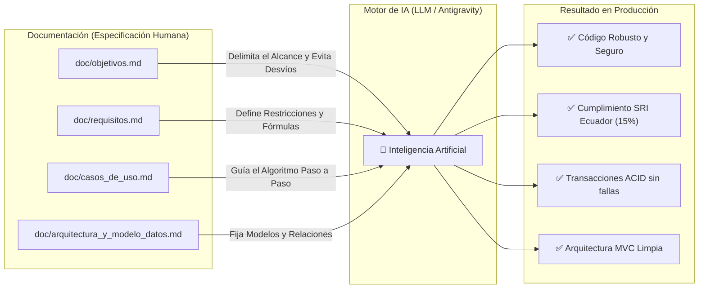

# 🧠 Guía Pedagógica: La Especificación como Contexto Esencial para la Inteligencia Artificial

> **Material docente para alumnos de Ingeniería de Software, Programación y Sistemas.**  
> *Autor*: Equipo Docente / Proyecto Facturador Simple Ecuador  
> *Propósito*: Demostrar con evidencia práctica por qué redactar especificaciones formales (Objetivos, Requisitos y Casos de Uso) es más importante hoy que nunca en la era de los Asistentes de IA (LLMs).

---

## 💡 1. El Gran Paradigma: De "Escribir Sintaxis" a "Especificar y Dirigir Sistemas"

Durante décadas, la enseñanza de la programación se centró en aprender la sintaxis de un lenguaje: bucles `for`, condicionales `if/else`, punteros y estructuras de datos.

Con la llegada de modelos de lenguaje avanzados (LLMs como Claude, GPT-4, Gemini o Antigravity), **la sintaxis se ha vuelto un *commodity*** (cualquier IA puede escribir un bucle en Python en milisegundos). Sin embargo, esto ha creado una peligrosa ilusión en los estudiantes:

> ⚠️ **El espejismo del estudiante novato:**  
> *"Ya no necesito estudiar análisis ni diseño de sistemas. Solo le pido a la IA que programe todo y listo."*

### La Realidad del Desarrollo Profesional:
Si le pides a una Inteligencia Artificial que construya una casa sin planos, te entregará una estructura con puertas que no abren, paredes sin vigas y tuberías que se cruzan con la red eléctrica. Se verá bonita por fuera (código limpio y formateado), pero colapsará en producción al primer usuario concurrente.

**El rol del nuevo ingeniero de software no es teclear caracteres: es ser el Arquitecto y Auditor del Sistema.** Y para auditar y dirigir a una IA, el lenguaje de comunicación formal son los **documentos de requerimientos**.

---

## 💥 2. El Principio *"Garbage In, Garbage Out"* aplicado a los LLMs

Los modelos de lenguaje funcionan probabilísticamente prediciendo la siguiente palabra (*token*) más probable según su base de entrenamiento. **No leen tu mente ni conocen el contexto de tu país o de tu negocio a menos que tú se lo proporciones.**

¿Qué ocurre si le das a una IA un prompt ambiguo?

```
❌ Prompt Vago del Estudiante:
"Hola, hazme un sistema de facturación con inventario en Django y Bootstrap para vender productos."
```

### Las 6 Alucinaciones y Desastres Típicos que generará la IA sin especificaciones:

| Problema / Falta de Especificación | Lo que la IA asume por defecto | Impacto en el Mundo Real (Ecuador) |
| :--- | :--- | :--- |
| **Tarifa de Impuestos** | Usa IVA del 16% (México), 21% (España) o 19% (Colombia). | **Ilegal en Ecuador**: Desde 2024 la tarifa general vigente es **15%**. La empresa recibiría multas inmediatas del SRI. |
| **Identificación de Clientes** | Campo de texto libre o validación de RFC/RUT/DNI extranjero. | Acepta números inválidos como "12345" o "ABC", haciendo inviables los comprobantes. |
| **Concurrencia de Inventario** | Hace `producto.stock -= cantidad` simple en la vista. | **Condición de carrera (*Race Condition*)**: Dos clientes compran el último televisor al mismo tiempo y el stock queda en `-1`. |
| **Transaccionalidad (ACID)** | Guarda la factura y luego descuenta el stock en pasos separados sin `transaction.atomic`. | Si se corta la conexión a mitad de proceso, la factura se crea pero el inventario no se descuenta (o viceversa). |
| **Tipos de Datos Financieros** | Utiliza números de punto flotante `float` (`10.50 + 0.1`). | Pérdida de precisión binaria (`10.500000000000002`), acumulando descuadres de centavos en la contabilidad. |
| **Arquitectura de Software** | Coloca 200 líneas de lógica SQL y cálculos en la función de la vista (*Fat View*). | Código espagueti imposible de probar con pruebas unitarias o reutilizar en una API móvil. |

---

## 🎯 3. La Documentación Técnica como "Ground Truth" (Fuente Única de Verdad)

Cuando los documentos de la carpeta `doc/` existen, dejan de ser simple "burocracia documental" para convertirse en el **Contexto Inyectado (*System Context*)** que condiciona matemáticamente a la IA:



1. **`objetivos.md` delimita el alcance**: Le impide a la IA inventar módulos innecesarios (como pasarelas de pago con Stripe o criptomonedas) y la enfoca en el ecosistema ecuatoriano.
2. **`requisitos.md` fija las reglas no negociables**: La obliga a usar `Decimal`, `ROUND_HALF_UP`, Módulo 10 para cédulas y RBAC estricto.
3. **`casos_de_uso.md` le da el pseudocódigo paso a paso**: Le dice exactamente qué validar primero, qué bloquear en la base de datos y cómo gestionar las excepciones.
4. **`arquitectura_y_modelo_datos.md` le da la estructura relacional**: Impide que invente nombres de tablas redundantes o relaciones circulares.

---

## 🔬 4. Experimento Práctico para los Alumnos: Caso de Estudio Real

Analicemos dos formas de pedirle a una IA implementar la emisión de facturas y descuento de stock:

---

### 🔴 Caso A: El Prompt Impreciso (Sin Documentación)

```python
# PROMPT DEL ALUMNO:
# "Haz una función en views.py para guardar una factura y descontarle el stock al producto"

# CÓDIGO TÍPICO GENERADO POR LA IA:
def guardar_factura(request):
    cliente = Cliente.objects.get(id=request.POST.get('cliente_id'))
    producto = Producto.objects.get(id=request.POST.get('producto_id'))
    cantidad = int(request.POST.get('cantidad'))
    
    # ❌ ERROR 1: No valida stock suficiente antes de cobrar
    # ❌ ERROR 2: No usa transacción atómica (si falla a la mitad, datos corruptos)
    # ❌ ERROR 3: Sin control de concurrencia (dos usuarios pueden vender el mismo stock)
    # ❌ ERROR 4: Quema el IVA como 16% (impuesto de otro país)
    subtotal = float(producto.precio) * cantidad
    iva = subtotal * 0.16
    total = subtotal + iva
    
    factura = Factura.objects.create(
        cliente=cliente,
        total=total
    )
    
    # ❌ ERROR 5: No hay historial de Kardex para auditoría
    producto.stock = producto.stock - cantidad
    producto.save()
    
    return render(request, 'gracias.html')
```

> **Diagnóstico del profesor**: Este código es reprobatorio en cualquier empresa real. Genera descuadres contables, permite stock negativo y no cumple con la legislación tributaria.

---

### 🟢 Caso B: El Prompt Basado en Requisitos (Ingeniería de Software con IA)

```
PROMPT DEL ALUMNO PROFESIONAL:
"Actúa como un desarrollador senior de Django. Implementa la lógica de emisión de facturas
siguiendo estrictamente la especificación del Caso de Uso CU-05 (doc/casos_de_uso.md),
los requisitos funcionales RF-12 a RF-15 (doc/requisitos.md) y el requisito no funcional RNF-02.

Asegúrate de:
1. Usar la capa de servicios FacturacionService en services.py con @transaction.atomic.
2. Bloquear los productos con select_for_update() para evitar condiciones de carrera.
3. Lanzar ValidationError si el stock disponible es menor a la cantidad solicitada.
4. Calcular el IVA aplicando el 15% vigente en Ecuador y redondeo con Decimal(0.01).
5. Registrar cada movimiento en MovimientoInventario (Kardex) con tipo EGRESO_VENTA."
```

#### Código que la IA genera cuando recibe este contexto:

```python
# CÓDIGO GENERADO CON ESPECIFICACIÓN:
@classmethod
@transaction.atomic
def emitir_factura(cls, cliente: Cliente, items: list[dict], forma_pago: str = '01') -> Factura:
    """Implementa CU-05 con integridad ACID y bloqueo de concurrencia."""
    if not items:
        raise ValidationError("Debe incluir al menos un producto en la factura.")

    emisor = Emisor.get_emisor()
    numero_factura = emisor.obtener_siguiente_numero()  # 001-001-000000001

    factura = Factura.objects.create(
        numero_factura=numero_factura,
        secuencial=emisor.secuencial_actual,
        cliente=cliente,
        forma_pago=forma_pago,
        estado='EMITIDA'
    )

    for item in items:
        # ✅ Bloqueo de fila a nivel de BD para control de concurrencia
        producto = Producto.objects.select_for_update().get(id=item['producto_id'], activo=True)
        cantidad = Decimal(str(item['cantidad']))

        # ✅ Validación de stock estricta
        if not producto.tiene_stock_suficiente(cantidad):
            raise ValidationError(
                f"Stock insuficiente para '{producto.nombre}'. Disponible: {producto.stock}, Solicitado: {cantidad}."
            )

        # ✅ Cálculos con precisión Decimal y tarifa SRI
        subtotal_linea = redondear(cantidad * producto.precio_unitario)
        iva_linea = redondear(subtotal_linea * (producto.tarifa_iva / Decimal('100.00')))

        # ✅ Descuento automático de inventario
        stock_previo = producto.stock
        producto.stock -= cantidad
        producto.save(update_fields=['stock'])

        # ✅ Registro inmutable en Kardex
        MovimientoInventario.objects.create(
            producto=producto,
            tipo='EGRESO_VENTA',
            cantidad=cantidad,
            stock_anterior=stock_previo,
            stock_nuevo=producto.stock,
            factura=factura,
            motivo=f"Venta en factura {numero_factura}"
        )

    emisor.secuencial_actual += 1
    emisor.save(update_fields=['secuencial_actual'])
    return factura
```

> **Diagnóstico del profesor**: Código impecable, transaccional, seguro contra condiciones de carrera, trazable contablemente y 100% acorde a la ley de Ecuador.

---

## 🛠️ 5. Metodología de Desarrollo con IA para Estudiantes (Framework "Spec-First")

Para enseñar a sus alumnos a desarrollar proyectos de software utilizando asistentes de IA como profesionales, aplique este ciclo de 5 pasos:

```
    ┌─────────────────────────────────────────────────────────────┐
    │ 1. ESPECIFICAR                                              │
    │ Redactar Objetivos, Requisitos (RF/RNF) y Casos de Uso.     │
    └──────────────────────────────┬──────────────────────────────┘
                                   │
    ┌──────────────────────────────▼──────────────────────────────┐
    │ 2. MODELAR Y DISEÑAR                                        │
    │ Definir el Diagrama Entidad-Relación y la Arquitectura.     │
    └──────────────────────────────┬──────────────────────────────┘
                                   │
    ┌──────────────────────────────▼──────────────────────────────┐
    │ 3. CONTEXTUALIZAR A LA IA                                   │
    │ Cargar los archivos de doc/ en el contexto del chat.        │
    └──────────────────────────────┬──────────────────────────────┘
                                   │
    ┌──────────────────────────────▼──────────────────────────────┐
    │ 4. GENERAR POR MÓDULOS (Iterativo)                          │
    │ Un caso de uso a la vez (Nunca pedir todo el sistema junto).│
    └──────────────────────────────┬──────────────────────────────┘
                                   │
    ┌──────────────────────────────▼──────────────────────────────┐
    │ 5. AUDITAR Y VALIDAR (Testing)                              │
    │ Ejecutar pruebas unitarias y verificar contra requisitos.   │
    └─────────────────────────────────────────────────────────────┘
```

---

## 📜 6. El Decálogo del Desarrollador en la Era de la Inteligencia Artificial

1. **La IA es tu copiloto, tú eres el capitán:** La responsabilidad legal, ética y técnica de cada línea de código es exclusivamente tuya, no del modelo.
2. **Sin requisitos claros, la IA solo acelera la producción de errores:** Generar 1000 líneas de código defectuoso en 5 segundos no es productividad; es deuda técnica instantánea.
3. **El contexto es el rey:** Entre mejor documentado esté tu dominio de negocio (normativas locales, flujos, casos extremos), más brillante será la respuesta de la IA.
4. **Desconfía y verifica:** Todo código autogenerado debe auditarse buscando condiciones de carrera, inyecciones de seguridad y errores de precisión numérica.
5. **Aprende a diseñar antes de aprender a pedir:** Quien no sabe cómo funciona una transacción ACID o un algoritmo de Módulo 10, jamás sabrá si la IA lo implementó correctamente.
